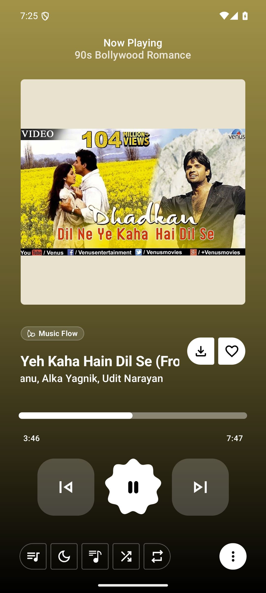
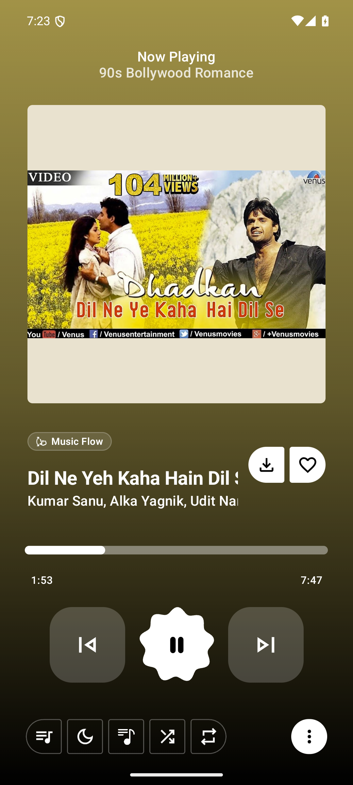
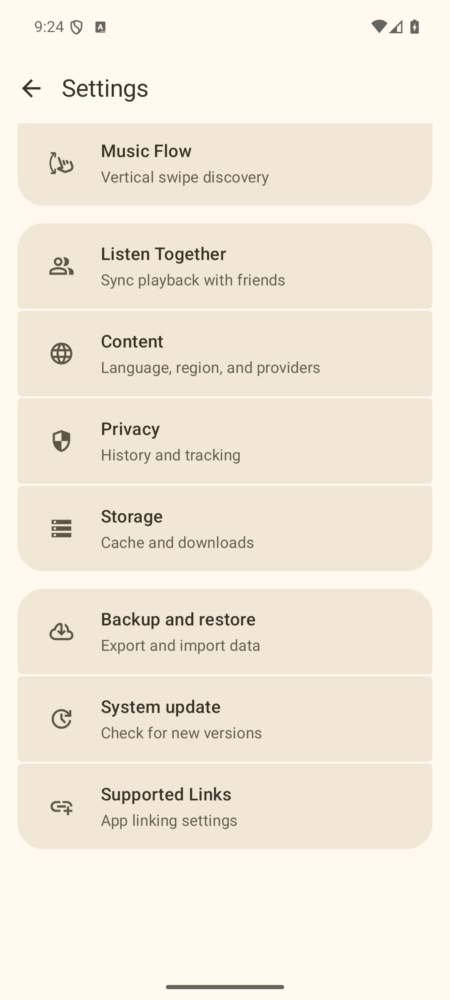

# MuhMeiMusic

A smooth, ad-free music player for Android. Local playback, YouTube Music style streaming, offline downloads, lyrics, and a queue that actually behaves.

**Made with all the open source things.**

---

## Download

Grab the latest `MuhMeiMusic.apk` from [Releases](../../releases) and install it (allow "install unknown apps" for your browser or file manager).

- Package: `echo.music.iad1tya`
- Version: 1.4.6
- Min Android: 8.0 (API 26) — tested on Android 15
- Size: ~148 MB
- Signed with a self-signed release key, so updates must come from this repo (install over the old build, don't mix with other apps' signatures).

## What's inside

- **Playback** — gapless queue, shuffle/repeat, crossfade, audio focus handling, MediaSession with lock screen + notification controls
- **Library** — songs, artists, albums, playlists, folders; instant local index
- **Search** — songs, artists, albums, plus online catalog results
- **Streaming & downloads** — play online tracks or save them for offline listening
- **Lyrics** — synced lyrics view, plus a full-screen lyric mode
- **Music Flow / radio** — endless related tracks from any song
- **Equalizer** — built-in EQ and bass/surround controls
- **Sleep timer, playback speed, skip silence**
- **Backup & restore** — export/import your library and settings
- **Cast & Together** — send audio to a TV/speaker or listen with friends
- **Widgets and quick settings tile**
- **Material 3 UI** with dark/light theming and dynamic color
- **No ads, no trackers, no account required** to play local music

## Screenshots

| Home | Now Playing | Settings |
| --- | --- | --- |
|  |  |  |

## Building

The release APK in this repo is built from the decoded resource/smali tree kept in `apk-work/echo`:

```bash
java -jar tools/apktool.jar b apk-work/echo -o apk-work/muhmei-unsigned.apk
zipalign -f -p 4 apk-work/muhmei-unsigned.apk apk-work/muhmei-aligned.apk
apksigner sign --ks muhmei.keystore --out MuhMeiMusic.apk apk-work/muhmei-aligned.apk
```

The keystore used for the published builds is not included — sign with your own key if you rebuild, and uninstall the released build first (signatures differ).

## Updates

The app's built-in updater (Settings → Search → "App Updates") reads this repository's latest GitHub release and offers the APK attached to it. To ship an update:

1. Bump `versionName`/`versionCode` in the build and produce a new signed APK.
2. Create a release with a tag like `v1.4.7` (the leading `v` is stripped before comparing versions).
3. Attach the new `MuhMeiMusic.apk` to that release — the updater reads `tag_name`, `body` (changelog) and `assets[].browser_download_url`.
4. Write the changelog in the release notes; it's shown in the in-app changelog.

If no newer release exists, the app reports "Up to date" and stays quiet.

## Notes

- Audio playback was verified on an Android 15 emulator: MediaSession reports `PLAYING`, position advances, 48 kHz AudioTrack holds audio focus.
- The app talks to public music metadata/catalog endpoints; some features need network.
- This project is distributed under the GPL, like the players it grew out of. See `LICENSE`.

## Credits

Built on the shoulders of the open source Android music community — every player, library, and utility that came before it.

**Made with all the open source things.**
